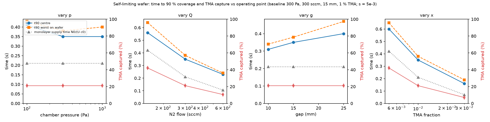

# ald-conformality


**A chamber-to-feature digital twin of atomic layer deposition, and the one-line rule it produced.**

ALD recipes are tuned on blank wafers. A 3D-NAND wafer carries 56x the surface area of the wafer under it. This
repository models a 300 mm showerhead ALD chamber in which every point on the wafer runs its own feature-scale model
of a high-aspect-ratio hole, two-way coupled to the chamber gas, and asks how long the pulse must be.

> **Result.** The pulse that saturates every hole bottom on the wafer is
> `t_pulse ≈ 1.2 × (1 + A_wall/A_wafer) × N0 / (U·c0)`:
> 1.2 times the time the showerhead needs to deliver one monolayer of precursor to the patterned area.
> It held within 25 % across aspect ratios 20-100 and a 20x range of precursor feed. Blank wafer: 0.35 s. Product
> wafer: 14 s. Pressure, gap and carrier flow do not move it; precursor delivery rate does.

The rule reproduces Argonne's measured fluidized-bed ALD saturation (1.12x the supply limit by their own numbers) and
the trend of their rotary-drum utilization data; the feature model agrees with Argonne's Machball code to 7 % and fits
published PillarHall thickness profiles.

| | |
|---|---|
|  |  |
| Saturating pulse vs feed fraction, blank and patterned wafers, with the supply limit dotted | Simulations, theory and two measured systems on one axis |
|  |  |
| Loading: the patterned wafer starves the gas phase; hole bottoms saturate at 14 s (1 %) or 4.75 s (3 %) | Operating sweep: pressure and gap move uniformity, not time |

## What is in the box

| Piece | Where | What it does |
|---|---|---|
| Chamber model | `reactor/showerhead_*`, `reactor/edgering_*` | OpenFOAM v2606, axisymmetric showerhead chamber, laminar N2, pulsed precursor with a total-flux (Danckwerts) inlet |
| Multiscale wall | `reactor/lib/aldWallKinetics` | Two OpenFOAM boundary conditions compiled with wmake: `langmuirSticking` (self-limiting flat surface, optional radical loss and desorption) and `patternedSurface` (a Knudsen/Langmuir hole model on every wafer face, two-way coupled) |
| Feature solver | `src/aldconf` | Python: Knudsen diffusion + Langmuir uptake in slits and holes, constant or time-driven mouth density, fitting, scaling tests |
| Cross-checks | `tests/` | Scaling laws, embedded-BC vs standalone solver, Machball (Argonne) ballistic model |
| Validation data | `data/zenodo_3974438` | PillarHall LHAR Al2O3 profiles (CC BY 4.0); fit in `coupling/fit_pillarhall.py` |
| Studies | `coupling/`, `reactor/sweep_*.py`, `reactor/doe_patterned.py` | One-way and two-way coupling, pulse-time map, operating sweep, DOE, PEALD ceiling, temporal-vs-spatial chart |
| Analysis | `analysis/` | JMP (JSL) response surface and MATLAB Gaussian-process surrogate with Monte Carlo bands |
| Paper | `paper/draft.md`, `paper/assumptions.md` | The write-up and the complete run log with every assumption |
| Audit | `CLAIMS.md` | Every number in this README traced to a file and a script |

## Reproduce

Apple Silicon Mac; everything open source except MATLAB and JMP, which are used only for the surrogate and DOE tables.

```bash
# Python side (feature solver, tests, figures)
~/.local/bin/python3.12 -m venv .venv && .venv/bin/pip install -e . viennaps machball pytest
sh scripts/fix_viennaps_libomp.sh .venv          # macOS: ViennaPS and ViennaLS each bundle an OpenMP runtime
PYTHONPATH=src .venv/bin/python -m pytest -q      # 7 tests

# OpenFOAM side (chamber + multiscale wall): native build from github.com/gerlero/openfoam-app
OF=~/Applications/OpenFOAM-v2606.app/Contents/Resources/etc/openfoam
$OF -c 'cd reactor/lib/aldWallKinetics && wmake libso .'
$OF -c 'sh reactor/Allrun'                        # blanket-wafer chain, ~1 min
$OF -c '.venv/bin/python reactor/sweep_pattern_map.py'   # the headline map, 16 runs, ~25 min
```

Every figure in `figures/` is produced by a script named in `CLAIMS.md`.

## Method in one paragraph

Chamber: steady laminar N2 (300 Pa, 573 K, 300 sccm, Re 0.045), frozen for the species step; precursor as a passive
scalar with D from Chapman-Enskog scaling; gap Peclet number 0.09, so the inlet must fix total flux, not
concentration (a fixed-concentration inlet over-injects 11x). Wall: irreversible Langmuir on the flat surface; inside
each hole, quasi-steady Knudsen diffusion with a Langmuir sink (Ylilammi 2018), coverage advanced per cell per time
step; net uptake blends flat and hole-mouth fluxes by open-area fraction and enters OpenFOAM as a mixed condition.
Parameters: s = 5e-3 (TMA), 1e-4 (H2O), N0 = 4e18 /m2, 100 nm holes at 180 nm pitch, half the wafer patterned.

## Status

Draft 0.7 of the paper; definition of done tracked in the project notes. Private material is excluded from this
repository by design.

## Citation

See `CITATION.cff`. Validation data: Zenodo 3974438 (Puurunen and Ylivaara, Aalto, CC BY 4.0). Cross-check code:
Machball (Yanguas-Gil and Elam, Argonne). Measured anchors: Lu et al., JVST A 40 (2022); Coile et al., JVST A 38,
052403 (2020).

MIT License. Soham Kavathekar, University of Pennsylvania.
