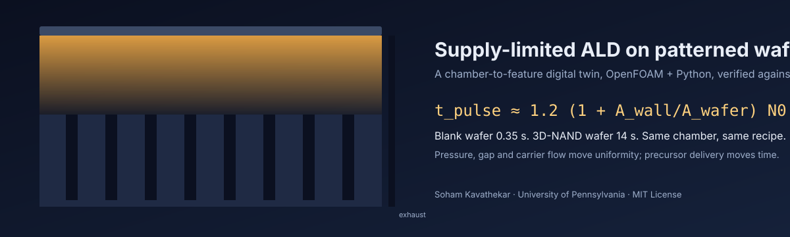
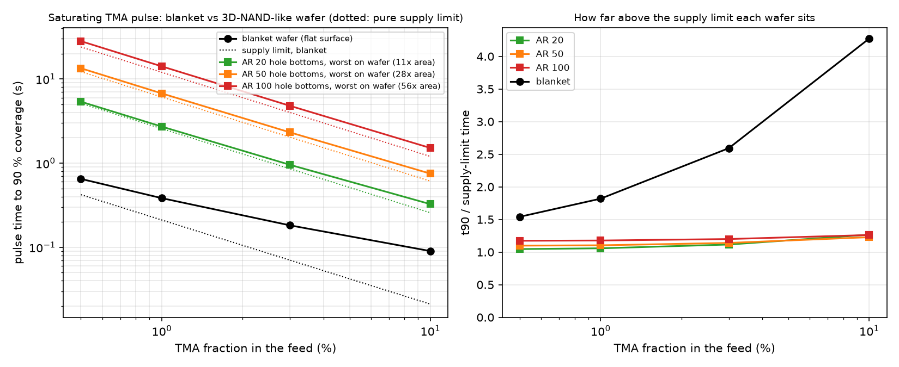
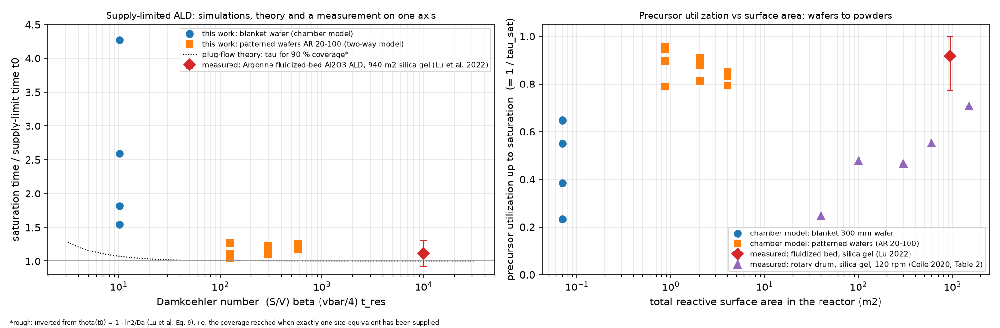
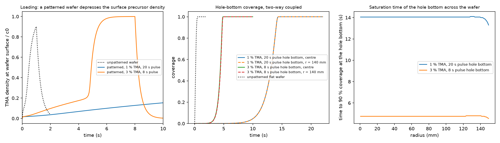
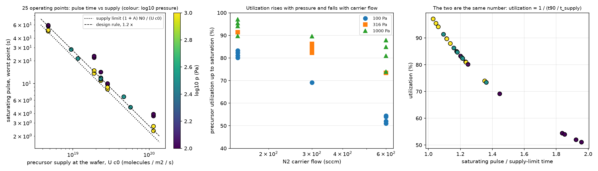
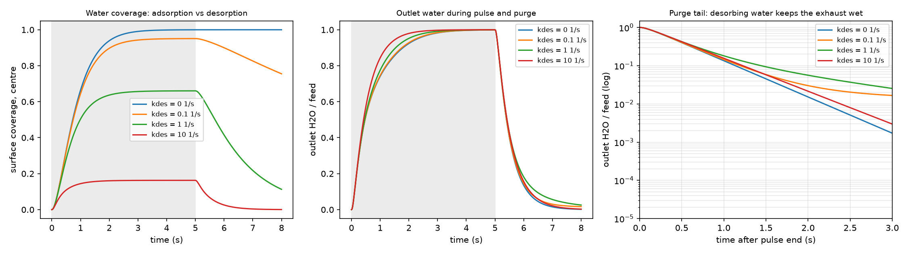
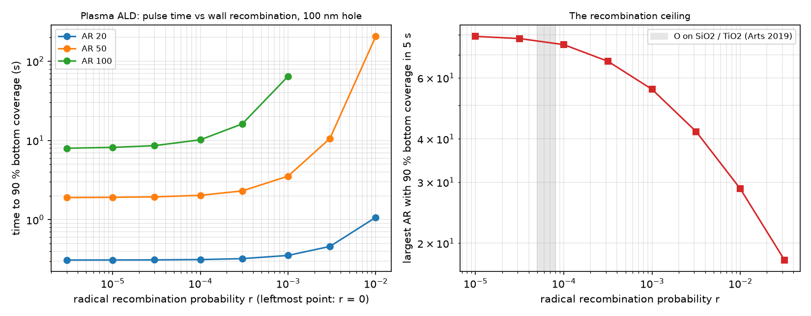

# ald-conformality

<p align="center"><a href="https://soham-cheme.github.io/ald-conformality/"></a></p>

<p align="center"><b><a href="https://soham-cheme.github.io/ald-conformality/">Open the live page</a></b> · scrub a 16-second pulse through the chamber, watch one hole fill from the mouth down, and run the rule and the surrogate on your own wafer</p>

**A chamber-to-feature digital twin of atomic layer deposition, and the one-line rule it produced.**

ALD recipes are tuned on blank wafers. A 3D-NAND wafer carries 56x the surface area of the wafer under it. This
repository models a 300 mm showerhead ALD chamber in which every point on the wafer runs its own feature-scale model
of a high-aspect-ratio hole, two-way coupled to the chamber gas, and asks how long the pulse must be.

> **Result.** The pulse that saturates every hole bottom on the wafer is
> `t_pulse ≈ 1.2 × (1 + A_wall/A_wafer) × N0 / (U·c0)`:
> 1.2 times the time the showerhead needs to deliver one monolayer of precursor to the patterned area.
> It held within 25 % across aspect ratios 20-100 and a 20x range of precursor feed. Blank wafer: 0.35 s. Product
> wafer: 14 s. Pressure, gap and carrier flow do not move it; precursor delivery rate does.

The rule reproduces Argonne's measured fluidized-bed ALD saturation (1.12x the supply limit by their own numbers) and
the trend of their rotary-drum utilization data; the feature model agrees with Argonne's Machball code to 7 % and fits
published PillarHall thickness profiles.

| | |
|---|---|
|  |  |
| Saturating pulse vs feed fraction, blank and patterned wafers, with the supply limit dotted | Simulations, theory and two measured systems on one axis |
|  |  |
| Loading: the patterned wafer starves the gas phase; hole bottoms saturate at 14 s (1 %) or 4.75 s (3 %) | 25-run DOE: pulse time follows supply; pressure up and carrier flow down raise utilization from 55 to 95 % |
|  |  |
| Water half-cycle with reversible adsorption: desorbing water sets the purge | Plasma ALD: radical recombination caps the reachable aspect ratio |

## Night three: the reviewer's questions

Seven follow-ups, each answered with runs rather than argument (details in `paper/wp/`, run logs in `paper/assumptions.md`, every number in `CLAIMS.md`):

- **Sticking coefficient.** Nine new chamber runs from s = 5 × 10⁻⁴ to 8.5 × 10⁻³ (the published TMA range plus this repository's PillarHall fit): the AR-100 wafer saturates in 14.00 to 14.20 s in every case, 1.17 to 1.18× the supply limit; the blanket wafer moves from 1.01 to 0.33 s. The rule and the map do not depend on s (`figures/sticking_sensitivity.png`).
- **Fab units.** The rule's pulse gives 99 % step coverage, not just 90 % (the front is 0.3 s wide). A 10 µm hole purges in 14 µs; the chamber reaches 1 % in 1.9 s; desorbing water can hold the exhaust up for 8 s. An Al₂O₃ cycle is 12 s on a blanket wafer and 38 s on the product wafer: 5.5 against 1.9 wafers per hour for 5 nm (`figures/cycle_time_wph.png`).
- **Chamber-scale checks.** The blanket surface exposure (1,090 L) sits within a factor 1.8 of the three published 300 °C kinetic values; an axisymmetric approximation of the Fiji F200 of Gakis et al. reproduces their CFD's delivered exposure to 12 to 22 % and the measured saturation state, but not their 2.4 % non-uniformity, which comes from asymmetries the wedge cannot carry (`figures/validation_gakis.png`).
- **A full 3D chamber with a one-sided pump** (106,000 cells): azimuthal spread of the saturation time 0.96 % at r = 140 mm, worst point 14.17 s against 14.05 s in the wedge. A one-sided pump costs about 1 % of pulse time (`figures/chamber3d_t90_map.png`).
- **Layout-to-recipe tool** on the live page: zones in, per-zone local rule and recipe pulse out, with the lateral-feed margin calibrated on the two non-uniform runs.
- **Continuous integration and Docker**: 77 tests, the boundary conditions rebuilt and a regression pulse rerun in an OpenFOAM container on every push.

## What is in the box

| Piece | Where | What it does |
|---|---|---|
| Chamber model | `reactor/showerhead_*`, `reactor/edgering_*` | OpenFOAM v2606, axisymmetric showerhead chamber, laminar N2, pulsed precursor with a total-flux (Danckwerts) inlet |
| Multiscale wall | `reactor/lib/aldWallKinetics` | Two OpenFOAM boundary conditions compiled with wmake: `langmuirSticking` (self-limiting flat surface, optional radical loss and desorption) and `patternedSurface` (a Knudsen/Langmuir hole model on every wafer face, two-way coupled) |
| Feature solver | `src/aldconf` | Python: Knudsen diffusion + Langmuir uptake in slits and holes, constant or time-driven mouth density, fitting, scaling tests |
| Cross-checks | `tests/` | Scaling laws, embedded-BC vs standalone solver, Machball (Argonne) ballistic model |
| Validation data | `data/zenodo_3974438` | PillarHall LHAR Al2O3 profiles (CC BY 4.0); fit in `coupling/fit_pillarhall.py` |
| Studies | `coupling/`, `reactor/sweep_*.py`, `reactor/doe_patterned.py` | One-way and two-way coupling, pulse-time map, operating sweep, DOE, PEALD ceiling, temporal-vs-spatial chart |
| Analysis | `analysis/` | JMP (JSL) response surface, MATLAB and scikit-learn Gaussian-process surrogates with Monte Carlo bands, cost-of-ownership front |
| Live page | `docs/` | The interactive 3D page (three.js) with the rule-and-surrogate calculator; `docs/build_assets.py` rebuilds its data from the cases, `docs/DESIGN.md` explains it |
| Paper | `paper/main.tex`, `paper/main.pdf`, `paper/draft.md`, `paper/assumptions.md` | The write-up (LaTeX and Markdown) and the complete run log with every assumption |
| Audit | `CLAIMS.md` | Every number in this README traced to a file and a script |

## Reproduce

Apple Silicon Mac; everything open source except MATLAB and JMP, which are used only for the surrogate and DOE tables.

```bash
# Python side (feature solver, tests, figures)
~/.local/bin/python3.12 -m venv .venv && .venv/bin/pip install -e . viennaps machball pytest
sh scripts/fix_viennaps_libomp.sh .venv          # macOS: ViennaPS and ViennaLS each bundle an OpenMP runtime
PYTHONPATH=src .venv/bin/python -m pytest -q      # 77 tests

# OpenFOAM side (chamber + multiscale wall): native build from github.com/gerlero/openfoam-app
OF=~/Applications/OpenFOAM-v2606.app/Contents/Resources/etc/openfoam
$OF -c 'cd reactor/lib/aldWallKinetics && wmake libso .'
$OF -c 'sh reactor/Allrun'                        # blanket-wafer chain, ~1 min
$OF -c '.venv/bin/python reactor/sweep_pattern_map.py'   # the headline map, 16 runs, ~25 min
```

Every figure in `figures/` is produced by a script named in `CLAIMS.md`.

### Try the surrogate in Python

The DOE surrogate is also fitted with scikit-learn (`analysis/doe_gp.py`, needs `pip install scikit-learn`) and
exported to `figures/doe_gp_python.json`, which `aldconf` evaluates with numpy alone:

```bash
PYTHONPATH=src .venv/bin/python -m aldconf rule --x 0.01 --Q 300 --p 300 --T 573 --AR 100 --d 100e-9 --density 1.78e13
PYTHONPATH=src .venv/bin/python -m aldconf surrogate --x 0.012 --Q 300 --p 316 --g 17.5
PYTHONPATH=src .venv/bin/python -m aldconf pareto --max-lag 5
```

The scikit-learn GP reproduces the MATLAB fitrgp leave-one-out R^2: 0.999 / 0.986 / 0.746 (Python) against 0.999 /
0.988 / 0.780 (MATLAB) for log10 pulse time / utilization / edge lag (`figures/doe_gp_python_report.txt`). The Pareto
front of pulse time against precursor use (`figures/doe_pareto.png`) cuts the TMA per wafer pass by 12 % at the
centre point's pulse time.

### Continuous integration and Docker


Every push runs three jobs: the Python feature solver and its 77 tests on Python 3.12; the OpenFOAM chain in
OpenCFD's `opencfd/openfoam-default:2512` container (the two boundary conditions compiled with wmake, the steady
chamber flow, a 2 s TMA pulse over a patterned wafer, and a regression test of the wafer coverage against a stored
reference to 1e-6); and a check that the live page ships every asset it references.

The same chain runs anywhere Docker runs, no OpenFOAM or Python install needed:

```bash
docker build -t ald-conformality . && docker run --rm ald-conformality        # the test suite, ~1 min after the build
docker run --rm ald-conformality --quick                                      # + steady flow, regression pulse and
                                                                              #   the Python analyses, 10-20 min
```

`docker run --rm ald-conformality --full` reruns every chamber study (hours). `reproduce.sh` in the repository root is
the entry point the image uses; it also runs natively inside the OpenFOAM launcher.
```

Also update the test count in the existing Reproduce block: `PYTHONPATH=src .venv/bin/python -m pytest -q      # 77 tests` -> `# 77 tests`.

## Method in one paragraph

Chamber: steady laminar N2 (300 Pa, 573 K, 300 sccm, Re 0.045), frozen for the species step; precursor as a passive
scalar with D from Chapman-Enskog scaling; gap Peclet number 0.09, so the inlet must fix total flux, not
concentration (a fixed-concentration inlet over-injects 11x). Wall: irreversible Langmuir on the flat surface; inside
each hole, quasi-steady Knudsen diffusion with a Langmuir sink (Ylilammi 2018), coverage advanced per cell per time
step; net uptake blends flat and hole-mouth fluxes by open-area fraction and enters OpenFOAM as a mixed condition.
Parameters: s = 5e-3 (TMA), 1e-4 (H2O), N0 = 4e18 /m2, 100 nm holes at 180 nm pitch, half the wafer patterned.

The pattern can also vary across the wafer: `patternedSurface` takes optional `ARProfile` and `holeDensityProfile`
tables of (radius, value) pairs, interpolated at each wafer face, so hole depth and hole density become functions of
radius (`reactor/make_layout_cases.py`, `coupling/postprocess_layout.py`). A dense AR-100 array confined to r < 75 mm
with bare wafer beyond 100 mm saturates its hole bottoms in 11.85 s at the centre instead of the uniform wafer's
14.05 s, while the bare edge takes 0.40-0.50 s instead of the blanket wafer's 0.35-0.38 s: the array draws down the gas
over the edge and the edge feeds the array back. A depth ramp from AR 100 at the centre to AR 60 at the edge gives
12.5 s at the centre and 7.6 s at the edge, tracking the local aspect ratio. In both cases the supply rule holds only
with the local wall-area ratio of the most demanding region (conservative by 15-21 %), not the wafer average
(`figures/pattern_layout.png`).

## Status

Paper at draft 0.9.1: complete, typeset in `paper/main.tex` (`paper/main.pdf`, 14 pages); arXiv submission to follow. Live page at https://soham-cheme.github.io/ald-conformality/ with the rule-and-surrogate calculator.

## Citation

See `CITATION.cff`. Validation data: Zenodo 3974438 (Puurunen and Ylivaara, Aalto, CC BY 4.0). Cross-check code:
Machball (Yanguas-Gil and Elam, Argonne). Measured anchors: Lu et al., JVST A 40 (2022); Coile et al., JVST A 38,
052403 (2020).

MIT License. Soham Kavathekar, University of Pennsylvania.
