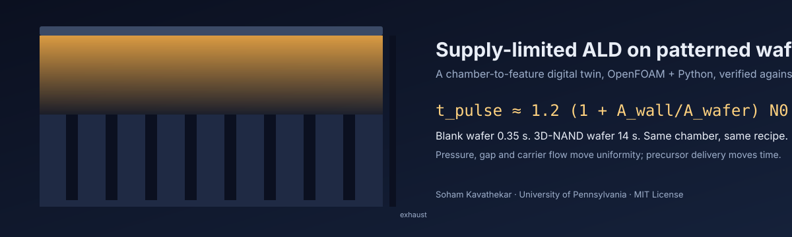
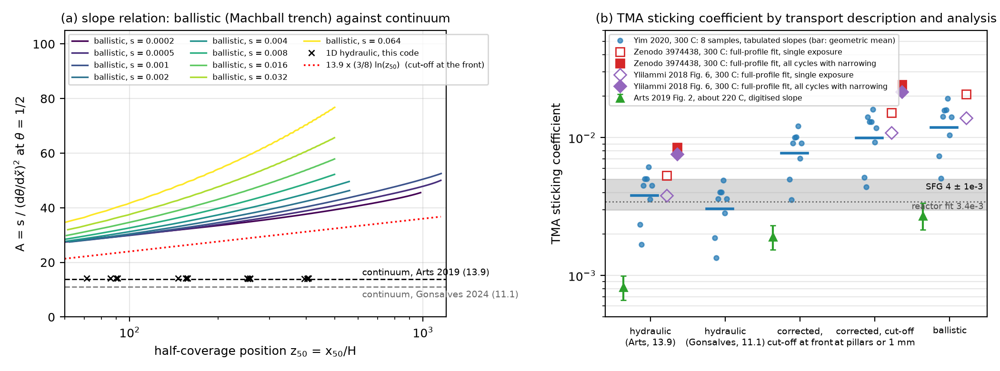
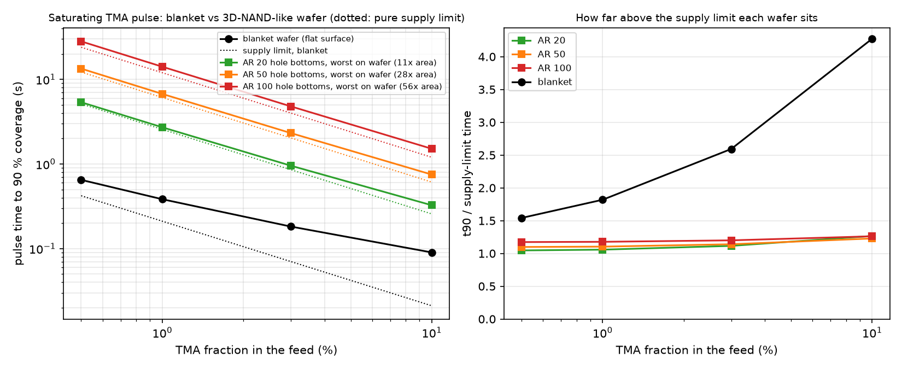
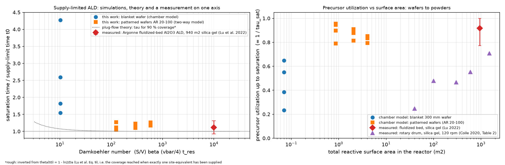
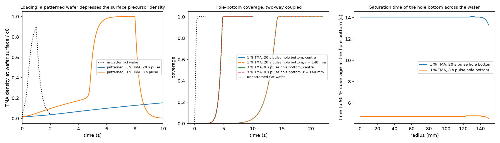
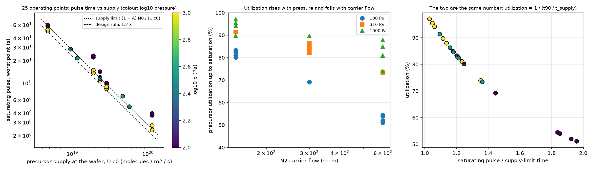
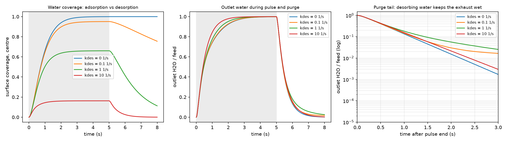
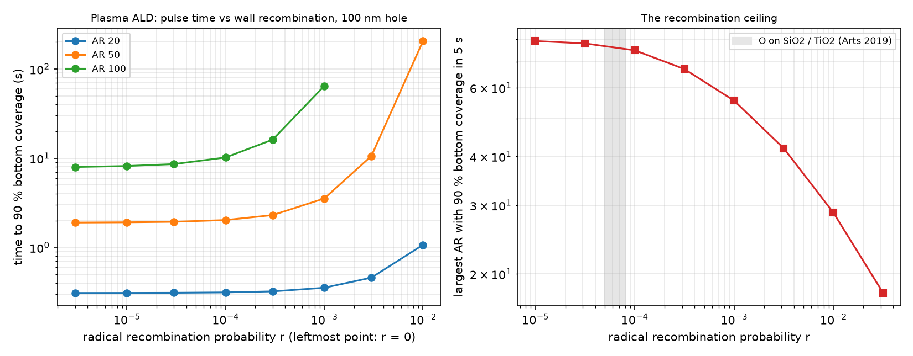

# ald-conformality

<p align="center"><a href="https://soham-cheme.github.io/ald-conformality/"></a></p>

<p align="center"><b><a href="https://soham-cheme.github.io/ald-conformality/">Open the live page</a></b> · scrub a 16-second pulse through the chamber, watch one hole fill from the mouth down, follow TMA into a PillarHall channel where the film narrows the gap over hundreds of cycles, and run the rule and the surrogate on your own wafer</p>

**An open chamber-to-feature model of atomic layer deposition: supply-limited pulse times on patterned wafers, and a ballistic re-analysis of the sticking coefficients extracted from lateral test structures.**

ALD recipes are tuned on blank wafers. A 3D-NAND wafer carries 56x the surface area of the wafer under it. This
repository models a 300 mm showerhead ALD chamber in which every point on the wafer runs its own feature-scale model
of a high-aspect-ratio hole, two-way coupled to the chamber gas, and asks how long the pulse must be.

> **Result.** The pulse that saturates every hole bottom on the wafer is
> `t_pulse ≈ 1.2 × (1 + A_wall/A_wafer) × N0 / (U·c0)`:
> 1.2 times the time the showerhead needs to deliver one monolayer of precursor to the patterned area.
> It held within 25 % across aspect ratios 20-100 and a 20x range of precursor feed. Blank wafer: 0.35 s. Product
> wafer: 14 s. Pressure, gap and carrier flow do not move it; precursor delivery rate does.

The rule is consistent with Argonne's measured fluidized-bed ALD saturation (1.12x the supply limit by their own numbers) and
the trend of their rotary-drum utilization data; the 1D feature model sits 2 to 11 % below the converged ballistic reference (Argonne's Machball and this repository's own 3D voxel Monte Carlo solver, which agree within 2 %) and fits
published PillarHall thickness profiles.

## Key results and where each one stands

- **The coupled chamber-to-feature prediction is not validated against a measurement.** The supply limit itself is a mass balance and coupled reactor-feature ALD models exist in the literature (Gobbert and Cale 1997 for CVD; Miyano et al. 2018; Yanguas-Gil et al. 2014, 2021; Christofides and co-workers; Chen et al. 2023; Lee et al. 2026). What this repository adds is an open, tested implementation for a 300 mm showerhead chamber and the computed prefactor (1.05 to 1.27, 1.03 to 1.96 over a 25-run design) with the list of what does not move it. No public dataset gives film thickness at depth together with pattern wall area, pulse and precursor delivery rate, so the prefactor is a model result. Miyano 2018 and Chen 2023 were read in full and lack the quantities a test needs.
- **A slit-transport correction.** One-dimensional slit models of lateral high-aspect-ratio (LHAR) test structures use the hydraulic-diameter Knudsen diffusivity, 2 H vbar/3, which is exact for a tube and low for parallel plates. The closed-form factor (3/8) ln(L/H), from Clausing's slit transmission and calibrated on Machball, brings the 1D slit model within 5 % of the ballistic solvers from aspect ratio 20 to 100.
- **Sticking coefficients from LHAR profiles are conditional on the transport model by a factor of about 3 (about 4 once channel narrowing is included, see below).** The three PillarHall-based TMA extractions examined (Ylilammi 2018, Arts 2019, Yim 2020) and the groups' public codes use the hydraulic diffusivity; Järvilehto et al. 2023 showed for one simulated channel that a ballistic model changes the extracted parameters. Carried through the published data with an ideal-slit ballistic solver:

  | Data (Al2O3 from TMA/water) | hydraulic | corrected | ideal-slit ballistic |
  |---|---|---|---|
  | Zenodo 3974438, 300 C, single-exposure full-profile fit | 5.3e-3 | 1.5e-2 | 2.1e-2 |
  | Ylilammi et al. 2018 Fig. 6, 300 C, single-exposure full-profile fit | 3.8e-3 | 1.1e-2 | 1.4e-2 |
  | Yim et al. 2020, eight samples at the same conditions, tabulated slopes, 300 C | 3.8e-3 | 7.7e-3 to 9.9e-3 | 1.2e-2 |
  | Arts et al. 2019 Fig. 2, TMA-limited, about 220 C, digitised | 8.2e-4 | 1.9e-3 | 2.7e-3 |

  For an ideal slit the ballistic counterpart of the slope relation s = A x slope^2 has A = 14.7 z50^0.30 s^0.12 (29 to 77) against the continuum 13.9. Fits that include channel narrowing over all cycles give higher values still (hydraulic 7.6e-3 and 8.5e-3 for the two full profiles).
- **The measured profiles do not look like an ideal ballistic slit.** With the same two parameters the continuum front shape fits both full profiles better (mean-square residual lower by factors 3.9 and 2.3; seven of eight Zenodo scans): an ideal ballistic slit predicts a slow tail ahead of the front that the data lack. The ballistic values above are therefore what an ideal slit would imply, not measurements, and the real cavities transport less ballistically than an ideal slit, or the kinetics are not a single Langmuir step.
- **The real pillar layout does not explain it.** A Monte Carlo of the real cavity geometry tests the geometric explanation (`lib/pillarmc`, exact plates and cylinders; it reproduces Machball on the ideal slit within 2.4 % in front position and 2 % in slope). With the standard PillarHall layout (4 um pillars at 49 um) and 90 um between diffuse side walls, the exposure that puts the front 215 heights deep rises by 3 % over the ideal slit (3.26 against 3.17 Pa s; the hydraulic model needs 6.23) and the coverage 60 heights ahead of the front falls from 0.089 to 0.071: the real layout transports like an ideal slit and keeps the ballistic tail. Fitted to the two profiles it gives s = 1.8e-2 and 1.2e-2 with residuals of 0.020 and 0.023, still worse than the continuum shape (0.012 and 0.017). Only a much denser array changes this: pillars at 10 um spacing need 5.6 Pa s, the hydraulic value, and lose the tail. So neither the pillars nor the width of the PillarHall-3 cavity explains why the measured fronts look continuum-like; what was left open at this point (wall scattering, carrier gas, channel narrowing, kinetics, the measurement) is tested in the next three items: the wall laws tried do not remove the tail, and carrier-gas collisions remove most of it.
- **At the filled fractions of the published samples (about 20 %), channel narrowing and the measurement spot account for most of the sample-to-sample variation of the front slope, and that limits what the slope says about the sticking coefficient.** The film grown in earlier cycles narrows the gap, later cycles penetrate less, and the cumulative front is smeared. The mechanism is not new. Perez et al. (2008) iterated a sharp-front profile over 100 cycles in a narrowing pore and matched a measured taper; Yazdani et al. (2014) state that the depth gradient comes from the cycle-to-cycle fall of the penetration depth; Knoops et al. (2010) warn that a front slope may reflect narrowing; narrowing is part of the Ylilammi 2018 model, and Yim et al. (2020, 2022) describe and simulate it and recommend keeping the filled fraction below 10 % and 5 %. What is added here is a closed form with no parameter fitted to the data and a quantitative out-of-sample test. The N-cycle profile is the single-exposure profile averaged over a stretch factor uniform between 1 - 2t/H and 1 (t film thickness, H gap). Against the multi-cycle hydraulic model it is within 0.011 of the plateau (0.021 where the film closes the gap; fronts 71 to 136 heights deep); against a multi-cycle Monte Carlo of the real cavity with the film on the plates it is within 1.1 % in depth and 2.2 % in slope up to 40 % filled, with and without carrier gas (4.6 % in slope at the lowest sticking coefficient tried, 0.004), when the stretch is raised to the power 0.92 (7 % low in slope at 40 % with the power 1); and against the independent multi-cycle simulation table of Yim 2022 within 0.4 % and 3 %. One sticking coefficient is calibrated on two full profiles (Zenodo 3974438, Ylilammi 2018 Fig. 6) and frozen; the front slopes of the other samples (Yim 2020 cycle, gap, pillar-layout, spot-size and purge series; Haimi 2021 EDS) are then predicted for three transport models (`docs/paper/mechanism_test.py`):

  | rms error of ln(slope), 13 samples common to all models | hydraulic | ballistic (real cavity) | with N2 collisions at 300 Pa |
  |---|---|---|---|
  | transport model alone | 0.36 | 0.41 | 0.36 |
  | + measurement spot | 0.29 | 0.34 | 0.30 |
  | + channel narrowing | 0.23 | 0.22 | 0.26 |
  | + both | 0.11 | 0.10 | 0.13 |

  Fifteen samples were scored; the table uses the 13 that all three kernels cover, which leaves out the 100 nm and 2000 nm gaps. On all 15 the complete hydraulic and gas models give 0.20 and 0.16, and the 2000 nm sample is the worst (predicted 0.025 and 0.032 against 0.047 measured). Five runs of the same pulse recipe (two with different purge times) scatter by 0.13 in ln(slope x depth) and by 0.25 in ln(slope), most of the latter following the front depth. With both effects the 100 nm gap, which the film closes, is brought from a factor 3 to 4 off (0.016 to 0.021) to within 16 and 24 % (0.0058 and 0.0062 against 0.0050 measured), and the per-cycle exposure implied by the 250, 500 and 1000-cycle samples varies by 17 % without a trend (4.8, 4.0, 4.4 Pa s with the gas model) instead of falling monotonically by 30 % (4.4, 3.4, 3.1). Narrowing does not improve the fit to the two calibration profiles themselves (joint rms without and with narrowing and spot: 0.0167 and 0.0195 hydraulic, 0.0167 and 0.0166 gas, 0.0232 and 0.0208 ballistic): the support for it is the variation of the held-out slopes, not the shape of the calibration profiles. The test is out of sample but not blind: the held-out table was known when the models were built.
- **With narrowing included, the three transport models fit the slopes equally well with different sticking coefficients.** Calibrated on the two profiles: 8.8e-3 (hydraulic; 6.6e-3 to 1.3e-2 within 5 % of the best rms), 1.7e-2 (gas at 300 Pa; 1.2e-2 to 2.4e-2; the interval reflects the flatness of the fit only, pressure and collision diameter were not varied), 3.6e-2 (ballistic). The published slope-method values at 300 C (about 4e-3) come from 500-cycle samples in a 500 nm gap, about 20 % filled. For five held-out samples of that recipe the measured slopes are at 74 to 92 % of the ceiling the complete gas model reaches for large s (77 to 95 % hydraulic, 86 to 108 % ballistic), and in the gas model the slope responds to s with an exponent of 0.25 to 0.28 at s = 0.01 and 0.14 to 0.17 at 0.02 (0.31 to 0.33 at 4e-3 in the hydraulic model) instead of the 0.5 the slope method assumes. Two samples keep most of their sensitivity and they disagree: the 250-cycle sample gives 1.2e-2 and the 2000 nm gap 4.1e-2 (gas model; 7.1e-3 and 3.4e-2 hydraulic). The Yim 2020 supplement reports fabrication problems for the 2000 nm channels (rounded features, some channels lost or narrowed); the sample is kept in every score and results are given with and without it: a single s over all slopes is 2.0e-2 (1.6e-2 to 2.6e-2) with it and 1.1e-2 (1.0e-2 to 1.4e-2) without (gas model). The Arts 2019 front (substrate about 220 C, 18 % filled, 486 heights deep, digitised with 9 % slope uncertainty) is at 78 % of its ceiling and corresponds to about 2.6e-3 with gas and 3.5e-3 without; that paper does not state the reactor pressure or carrier gas, and 27 Pa of argon is assumed. Within the reading error this is consistent with the upper end of the published (0.5 to 2)e-3. Against the central optical value of 4e-3 the complete-model values at 300 C are about 2 times (hydraulic, 7.3e-3 to 8.8e-3), 3 to 5 times (gas, 1.1e-2 to 2.0e-2) and 9 times (ballistic, 3.6e-2) larger. They are not reconciled with it. Both are initial per-collision probabilities under a first-order law; the optical one scales with the assumed site density and with a flux known to within an order of magnitude, so the difference is inside its stated systematic error and cannot be attributed from these data. The gas-model value also depends on the carrier pressure taken inside the channel: 1.1e-2 at 1000 Pa, 1.7e-2 at 300 Pa, about 3.5e-2 at 100 Pa (`figures/mechanism_pressure_sensitivity.csv`).
- **A function for the corrected slope method.** `aldconf.lhar.sticking_from_slope(slope, z50, fill, transport)` returns the sticking coefficient of the complete model with an interval, the sensitivity of the slope to s, and a flag when the slope no longer limits s. For Yim 2020 sample 4 (slope 0.019 at 208 gaps, 19 % filled) the plain slope method gives 5.0e-3; the complete model gives 9.8e-3 (5.5e-3 to 3.6e-2) with hydraulic transport and 1.5e-2 (8.9e-3 to 3.7e-2) with gas at 300 Pa, for a 13 % error on the slope. The intervals are wide because the sensitivity is about 0.2, against 0.5 for an unfilled channel. Valid for a 500 nm gap, depths of 150 to 300 gaps, up to 40 % filled.
- **What a profile can and cannot determine.** Given the transport model, a full profile pins s down well even when the slope does not: the best possible 1-sigma factor on s (noise 0.03 of the plateau, 100 points) is 1.1 up to 10 % filling, 1.2 at 20 % and 1.55 at 40 %, while the slope alone gives 2.1 at 20 % and nothing at 30 %. What a profile cannot do is choose the transport model: a profile generated with carrier-gas collisions is fitted by the hydraulic model to within 0.004 to 0.007, far below the noise, with a sticking coefficient 0.5 to 0.9 times the true one. So the factor of two between the hydraulic and the gas-collision values is not resolvable from profile shape. The loss of slope sensitivity follows one number, u = f x z50/(1 - f/2) x slope without narrowing: sensitivity falls as 1/(1 + (u/0.92)^3), keeping 80 % for u < 0.58 (`aldconf.lhar.relative_sensitivity`, `max_fill_for`). Two measurements would separate the transport models without knowing s or the dose: the reduced depth in a 2000 nm gap over a 500 nm gap in one run (0.91 with gas collisions, 0.97 to 0.98 without; the published pair gives 0.90 but is not stated to share a run), and the depth at two carrier pressures (0.85 between 1000 and 100 Pa, against 0.98 for hydraulic diffusion with Bosanquet).
- **Does treating every sample with the same physics make the published values agree? Partly.** For the 15 published fronts at 300 C the plain slope method gives 4.1e-4 to 3.2e-2, a factor of 78, because it reads the spot-size, cycle-number and closed-gap samples as differences in sticking. With narrowing, spot and measured gaps the range is a factor of 7 with gas collisions (6.2e-3 to 4.3e-2) and 11 with hydraulic transport. On the samples that have a value both ways the scatter of ln s falls from 0.71 to 0.57 (gas) and from 0.77 to 0.68 (hydraulic). It does not collapse: no single s lies inside every sample's one-sigma interval, with the 2000 nm sample at the high end and samples 2 and 6 at the low end (`figures/reextraction.csv`).
- **Carrier-gas collisions at 300 Pa cut the ballistic tail fourfold; the wall-scattering laws tried do not (the best, a cos^2 lobe, lowers it by 36 %).** `lib/pillarmc` now follows hard-sphere collisions of TMA with the N2 carrier (tracer diffusion coefficient within 1 % of first-order Chapman-Enskog in the reference run, `pillarmc diffusion 300`; the tests assert 5 %, and uniform equilibrium flux within 3 %). At the 300 Pa of the Picosun runs the collision mean free path of TMA in N2 is 19 um, 39 gap heights: free molecular by the usual criterion, but shorter than the flights of 60 to 100 heights that build the tail. For a front 215 heights deep at s = 0.0158 the coverage 60 heights ahead falls from 0.071 (no gas) to 0.045, 0.018 and 0.004 at 100, 300 and 1000 Pa (hydraulic model 0.001), and the exposure needed rises from 3.26 to 3.82 Pa s (hydraulic 6.23). Specular reflection (20 %, 50 %) raises the tail to 0.087 and 0.117; back-scattering and cos^2 to cos^8 re-emission lobes leave it at 0.045 to 0.071 (reduced particle budget). Three seeds at one condition (300 Pa, s = 0.02) reproduce the slope within 0.6 %; all other runs are single-seed.
- **The corrected values do not cluster on the independent ones (a negative result, stated as such).** The optical (sum-frequency generation) value is 4 +/- 1e-3 as listed in Arts 2019 (Table I); the source gives 3.9 +/- 0.4e-3 for steady growth with a site density of 6.0e14 cm-2, where the 0.4 is the random error and the flux carries a systematic error of "less than an order of magnitude" (Vandalon and Kessels 2019, Table 1). A reactor-scale fit gives 3.4e-3, with a simulated dose, so only the product of s and dose is constrained there. At 300 C the hydraulic slope and single-exposure values (3.8e-3 to 5.3e-3) coincide numerically with them; both analyses ignore channel narrowing, and with it the same hydraulic model gives 7.3e-3 to 8.8e-3, about twice the optical value, so this coincidence is not evidence of agreement; and ideal-slit ballistic values are three to five times it; the 220 C value is five times below it (hydraulic) or within 30 % (ballistic). An LHAR-derived sticking coefficient is conditional on the slit transport model, and neither transport model is validated for the real cavities. Which value is right is not settled here.

Sources, per-curve provenance and reading errors: `data/lhar_profiles/PROVENANCE.md`. Every number: `CLAIMS.md`.



| | |
|---|---|
|  |  |
| Saturating pulse vs feed fraction, blank and patterned wafers, with the supply limit dotted | Simulations, theory and two measured systems on one axis |
|  |  |
| Loading: the patterned wafer starves the gas phase; hole bottoms saturate at 14 s (1 %) or 4.75 s (3 %) | 25-run DOE: pulse time follows supply; pressure up and carrier flow down raise utilization from 55 to 95 % |
|  |  |
| Water half-cycle with reversible adsorption: desorbing water sets the purge | Plasma ALD: radical recombination caps the reachable aspect ratio |

## Night three: the reviewer's questions

Seven follow-ups, each answered with runs rather than argument (details in `paper/wp/`, run logs in `paper/assumptions.md`, every number in `CLAIMS.md`):

- **Sticking coefficient.** Eleven chamber runs from s = 5 × 10⁻⁴ to 2 × 10⁻² (the published TMA range and both PillarHall fits; the fit gives 8.5 × 10⁻³ with hydraulic slit transport and 2.0 × 10⁻² with the ideal-plate correction the 3D solver showed slits need, same residual, so the profile alone does not pin s): the AR-100 wafer saturates in 14.00 to 14.20 s in every case, 1.17 to 1.18× the supply limit; the blanket wafer moves from 1.01 to 0.28 s. The rule and the map do not depend on s (`figures/sticking_sensitivity.png`).
- **Fab units.** The rule's pulse gives 99 % step coverage, not just 90 % (the front is 0.3 s wide). A 10 µm hole purges in 14 µs; the chamber reaches 1 % in 1.9 s; desorbing water can hold the exhaust up for 8 s. An Al₂O₃ cycle is 12 s on a blanket wafer and 38 s on the product wafer: 5.5 against 1.9 wafers per hour for 5 nm. This is the gap production closes with batch vertical furnaces and multi-station chambers, which pay the long pulse once for many wafers (`figures/cycle_time_wph.png`).
- **Chamber-scale checks.** The blanket surface exposure (1,090 L) sits within a factor 1.8 of the three published 300 °C kinetic values; an axisymmetric approximation of the Fiji F200 of Gakis et al. reproduces their CFD's delivered exposure to 12 to 22 % and the measured saturation state, but not their 2.4 % non-uniformity, which comes from asymmetries the wedge cannot carry (`figures/validation_gakis.png`).
- **A full 3D chamber with a one-sided pump** (106,000 cells): azimuthal spread of the saturation time 0.96 % at r = 140 mm, worst point 14.17 s against 14.05 s in the wedge. A one-sided pump costs about 1 % of pulse time (`figures/chamber3d_t90_map.png`).
- **Device geometry and other chemistries.** Tapered holes cost 1 to 4 % of pulse time on the supply-limited wafer; word-line recesses fed through a slit behave as an area-equivalent slit within 4 % (the last recess lags the slit bottom by 0.5 to 9 %); HfO₂ from TDMAH saturates the AR-100 wafer in 11.6 s against a rule of 9.96 s, and the rule gives 4.4 s for TiN and 57 s for W from literature kinetics (`figures/tapered_hole.png`, `figures/wordline_recess.png`, `figures/chemistry_rule_table.csv`).
- **Device geometries with the 3D solver.** - **Device geometries in the voxel solver.** A stacked-nanosheet gate (IBM's 3 x 5 nm sheets at 10 nm, a four-sheet   7 nm variant, and the 4 nm slots left for TiN after the high-k) and 3D-NAND word-line cells with the channel-hole   pillars in the recesses (the 5 um cell of night three and a 2XX-layer cell: 12.7 um slit, 48 nm pitch, 1 um   recesses) run with TMA, TDMAH and TiCl4 at 0.3 Pa and under the chamber's centre-face history. The nanosheet stack   is a flat surface with a 2:1 slot (last point 18 % behind a blanket at 90 %, saturated well inside the rule's 1.7 s   pulse for a 5.7x wafer); the 2XX NAND cell needs 9.9 Pa s of TMA and a 448x wafer, 113 s by the rule; the last point   of a word-line stack sits five slit widths above the floor, not at it, which the 1D nested model cannot show   (`figures/device_geometries.png`, `figures/gaa_coverage.png`, `figures/nand_cell_coverage.png`,   `paper/wp/wp10_device_geometries.md`). No published per-sheet or per-word-line film thickness exists to compare   with: application, not validation.
- **Live page:** a layout-to-recipe tool (zones in, per-zone local rule and recipe pulse out, lateral-feed margin calibrated on the two non-uniform runs) and eleven new interactive 3D scenes for these results, from the sticking sweep to the 3D chamber's wafer map, the tapered holes and the word-line stack.
- **Continuous integration and Docker**: 77 tests, the boundary conditions rebuilt and a regression pulse rerun in an OpenFOAM container on every push.

## What is in the box

| Piece | Where | What it does |
|---|---|---|
| Chamber model | `reactor/showerhead_*`, `reactor/edgering_*` | OpenFOAM v2606, axisymmetric showerhead chamber, laminar N2, pulsed precursor with a total-flux (Danckwerts) inlet |
| Multiscale wall | `reactor/lib/aldWallKinetics` | Two OpenFOAM boundary conditions compiled with wmake: `langmuirSticking` (self-limiting flat surface, optional radical loss and desorption) and `patternedSurface` (a Knudsen/Langmuir hole model on every wafer face, two-way coupled) |
| Feature solver | `src/aldconf` | Python: Knudsen diffusion + Langmuir uptake in slits, holes, tapered holes and recessed slits, constant or time-driven mouth density, fitting, scaling tests; a two-species variant (`multispecies.py`) with byproduct re-adsorption and etching, which shows that methane cannot block TMA in the molecular-flow regime and that HCl re-adsorption can cost 10 to 50 % of pulse time in chloride chemistries |
| 3D feature solver | `lib/aldmc`, `src/aldconf/voxel.py` | C++ test-particle Monte Carlo on a voxel grid (molecular flow, Langmuir sticking, diffuse re-emission; holes, tapered holes, slits, recessed slits, any occupancy array); agrees with Machball within 2 % at AR 20 to 100; threaded and bitwise reproducible |
| Cross-checks | `tests/` | Scaling laws, embedded-BC vs standalone solver, 1D solver vs the 3D voxel solver vs Machball (Argonne); 118 tests |
| Validation data | `data/zenodo_3974438` | PillarHall LHAR Al2O3 profiles (CC BY 4.0); fit in `coupling/fit_pillarhall.py` |
| Studies | `coupling/`, `reactor/sweep_*.py`, `reactor/doe_patterned.py` | One-way and two-way coupling, pulse-time map, operating sweep, DOE, PEALD ceiling, temporal-vs-spatial chart |
| Analysis | `analysis/` | JMP (JSL) response surface, MATLAB and scikit-learn Gaussian-process surrogates with Monte Carlo bands, cost-of-ownership front |
| Live page | `docs/` | The interactive 3D page (three.js) with the rule-and-surrogate calculator; `docs/build_assets.py` rebuilds its data from the cases, `docs/DESIGN.md` explains it |
| Paper | `paper/main.tex`, `paper/main.pdf`, `paper/draft.md`, `paper/assumptions.md` | The write-up (LaTeX and Markdown) and the complete run log with every assumption |
| Audit | `CLAIMS.md` | Every number in this README traced to a file and a script |

## Reproduce

Apple Silicon Mac; everything open source except MATLAB and JMP, which are used only for the surrogate and DOE tables.

```bash
# Python side (feature solver, tests, figures)
~/.local/bin/python3.12 -m venv .venv && .venv/bin/pip install -e . viennaps machball pytest
sh scripts/fix_viennaps_libomp.sh .venv          # macOS: ViennaPS and ViennaLS each bundle an OpenMP runtime
cmake -S lib/aldkin -B lib/aldkin/build && cmake --build lib/aldkin/build   # the kinetics library (also built by reproduce.sh)
cmake -S lib/aldmc -B lib/aldmc/build && cmake --build lib/aldmc/build     # the 3D voxel Monte Carlo solver
PYTHONPATH=src .venv/bin/python -m pytest -q      # 118 tests

# OpenFOAM side (chamber + multiscale wall): native build from github.com/gerlero/openfoam-app
OF=~/Applications/OpenFOAM-v2606.app/Contents/Resources/etc/openfoam
$OF -c 'cd reactor/lib/aldWallKinetics && wmake libso .'
$OF -c 'sh reactor/Allrun'                        # blanket-wafer chain, ~1 min
$OF -c '.venv/bin/python reactor/sweep_pattern_map.py'   # the headline map, 16 runs, ~25 min
```

Every figure in `figures/` is produced by a script named in `CLAIMS.md`.

### Try the surrogate in Python

The DOE surrogate is also fitted with scikit-learn (`analysis/doe_gp.py`, needs `pip install scikit-learn`) and
exported to `figures/doe_gp_python.json`, which `aldconf` evaluates with numpy alone:

```bash
PYTHONPATH=src .venv/bin/python -m aldconf rule --x 0.01 --Q 300 --p 300 --T 573 --AR 100 --d 100e-9 --density 1.78e13
PYTHONPATH=src .venv/bin/python -m aldconf surrogate --x 0.012 --Q 300 --p 316 --g 17.5
PYTHONPATH=src .venv/bin/python -m aldconf pareto --max-lag 5
```

The scikit-learn GP reproduces the MATLAB fitrgp leave-one-out R^2: 0.999 / 0.986 / 0.746 (Python) against 0.999 /
0.988 / 0.780 (MATLAB) for log10 pulse time / utilization / edge lag (`figures/doe_gp_python_report.txt`). The Pareto
front of pulse time against precursor use (`figures/doe_pareto.png`) cuts the TMA per wafer pass by 12 % at the
centre point's pulse time.

### Use the kinetics in your own solver

The wall model (flat Langmuir surface plus a Knudsen/Langmuir hole per face, coverages integrated per time step,
`K_eff` returned for a Robin wall condition) is a standalone C-ABI library, `lib/aldkin` (`cmake -S lib/aldkin -B
lib/aldkin/build && cmake --build lib/aldkin/build`; `ctest` runs 11 checks). Three hooks exist:
- OpenFOAM: `reactor/lib/aldWallKinetics` are thin adapters around it (`patternedSurface`, `langmuirSticking`;
  bit-identical to the earlier boundary conditions on the regression case).
- Fluent: `adapters/fluent/ald_wall_udf.c` (DEFINE_INIT / DEFINE_ADJUST / DEFINE_SR_RATE); compiled against a stub,
  not yet run in Fluent.
- Any other code: `lib/aldkin/examples/plain_c_example.c` steps one face through a recorded chamber density history;
  Python through `aldconf.aldkin` (ctypes). API, units and the per-step call sequence: `lib/aldkin/README.md`.

### Continuous integration and Docker


Every push runs three jobs: the Python feature solver and its 118 tests on Python 3.12; the OpenFOAM chain in
OpenCFD's `opencfd/openfoam-default:2512` container (the two boundary conditions compiled with wmake, the steady
chamber flow, a 2 s TMA pulse over a patterned wafer, and a regression test of the wafer coverage against a stored
reference to 1e-6); and a check that the live page ships every asset it references.

The same chain runs anywhere Docker runs, no OpenFOAM or Python install needed:

```bash
docker build -t ald-conformality . && docker run --rm ald-conformality        # the test suite, ~1 min after the build
docker run --rm ald-conformality --quick                                      # + steady flow, regression pulse and
                                                                              #   the Python analyses, 10-20 min
```

`docker run --rm ald-conformality --full` reruns every chamber study (hours). `reproduce.sh` in the repository root is
the entry point the image uses; it also runs natively inside the OpenFOAM launcher.
```


## Method in one paragraph

Chamber: steady laminar N2 (300 Pa, 573 K, 300 sccm, Re 0.045), frozen for the species step; precursor as a passive
scalar with D from Chapman-Enskog scaling; gap Peclet number 0.09, so the inlet must fix total flux, not
concentration (a fixed-concentration inlet over-injects 11x). Wall: irreversible Langmuir on the flat surface; inside
each hole, quasi-steady Knudsen diffusion with a Langmuir sink (Ylilammi 2018), coverage advanced per cell per time
step; net uptake blends flat and hole-mouth fluxes by open-area fraction and enters OpenFOAM as a mixed condition.
Parameters: s = 5e-3 (TMA), 1e-4 (H2O), N0 = 4e18 /m2, 100 nm holes at 180 nm pitch, half the wafer patterned.

The pattern can also vary across the wafer: `patternedSurface` takes optional `ARProfile` and `holeDensityProfile`
tables of (radius, value) pairs, interpolated at each wafer face, so hole depth and hole density become functions of
radius (`reactor/make_layout_cases.py`, `coupling/postprocess_layout.py`). A dense AR-100 array confined to r < 75 mm
with bare wafer beyond 100 mm saturates its hole bottoms in 11.85 s at the centre instead of the uniform wafer's
14.05 s, while the bare edge takes 0.40-0.50 s instead of the blanket wafer's 0.35-0.38 s: the array draws down the gas
over the edge and the edge feeds the array back. A depth ramp from AR 100 at the centre to AR 60 at the edge gives
12.5 s at the centre and 7.6 s at the edge, tracking the local aspect ratio. In both cases the supply rule holds only
with the local wall-area ratio of the most demanding region (conservative by 15-21 %), not the wafer average
(`figures/pattern_layout.png`).

## Status

The earlier long write-up (`paper/main.tex`, `paper/main.pdf`, draft 0.9.5) is kept as the project record; its framing has been superseded by the prior-art review summarised above, and a shorter manuscript is in preparation. Live page at https://soham-cheme.github.io/ald-conformality/ with the rule-and-surrogate calculator.

## Citation

See `CITATION.cff`. Validation data: Zenodo 3974438 (Puurunen and Ylivaara, Aalto, CC BY 4.0). Cross-check code:
Machball (Yanguas-Gil and Elam, Argonne). Measured anchors: Lu et al., JVST A 40 (2022); Coile et al., JVST A 38,
052403 (2020).

MIT License. Soham Kavathekar, University of Pennsylvania.
